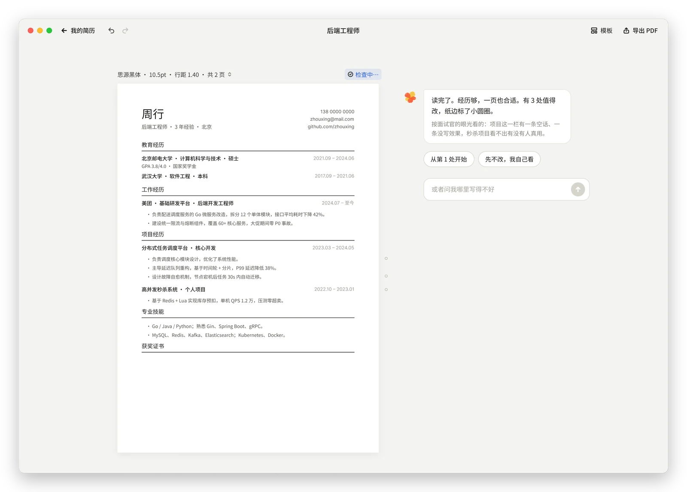
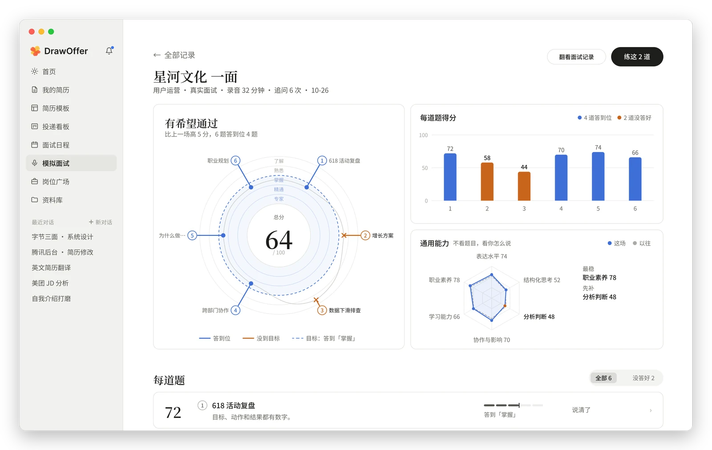
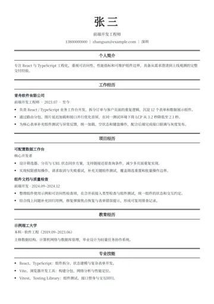
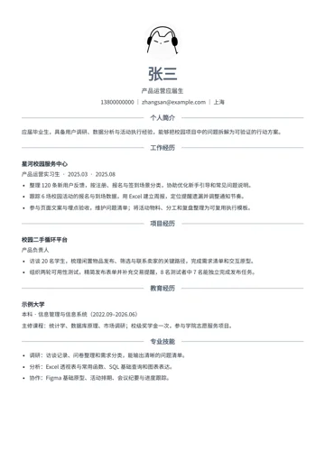
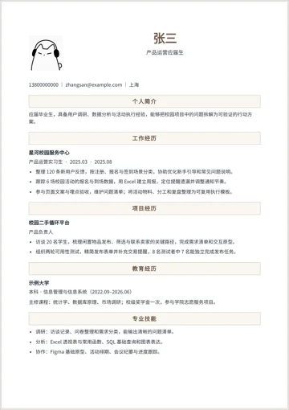
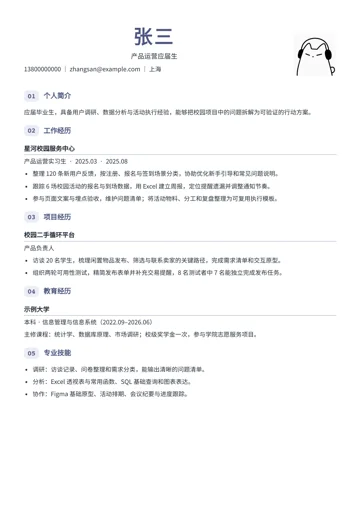
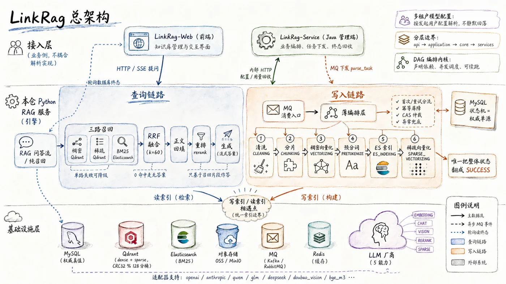

<h1>DrawOffer</h1>

<b>做懂你经历的 AI 求职搭档，也把背后的 RAG 与 AI 工程开源出来。</b> 
We build DrawOffer, an AI job-search partner with long-term memory, and open-source the RAG and AI tooling behind it.

<a href="https://www.drawoffer.com">官网</a> ·
<a href="https://www.drawoffer.com/assistant">在线使用</a> ·
<a href="https://www.drawoffer.com/templates">简历模板</a> ·
<a href="https://github.com/DrawOffer/drawoffer">桌面客户端</a> ·
<a href="https://linkrag.cn">LinkRag</a>

## DrawOffer 职绘

面向应届生和求职者的 AI 求职搭档。它把你的简历、投递、模拟面试和每一场真实面试存进**长期记忆**：改简历时知道你投的是哪个岗位，出题时知道你上次卡在哪里，下一场面试接着上一场往前走。

<table>
<tr>
<td width="50%"></td>
<td width="50%"></td>
</tr>
<tr>
<td align="center"><b>简历</b> · 按面试官的眼光检查，每处修改由你确认</td>
<td align="center"><b>复盘</b> · 每道题答到哪一层，和上一场比进步了多少</td>
</tr>
</table>

| 能力 | 说明 |
| --- | --- |
| 简历 | 所见即所得编辑，60+ 套中文模板，导入 PDF / Word / Markdown，导出 PDF |
| 岗位与投递 | 浏览器插件收藏岗位，看板记录每家进度，面试日程按日历排开 |
| 模拟面试 | 按岗位和简历出题追问，文字或语音作答，生成复盘报告 |
| 真实面试复盘 | 上传录音一题一题复盘，被问到的知识点记进图谱 |
| 长期记忆 | 知识图谱串起简历、岗位、练习和面试，标出还不牢的点 |
| AI 对话与资料库 | 基于你自己的求职记录提问，面经和笔记参与出题与改简历 |

**在哪里用**：[网页版](https://www.drawoffer.com/assistant) · 微信小程序 · [macOS / Windows 客户端](https://github.com/DrawOffer/drawoffer) · [MCP（Claude、Cursor）](https://github.com/DrawOffer/drawoffer-mcp)

### 免费中文简历模板

<table>
<tr>
<td width="25%"></td>
<td width="25%"></td>
<td width="25%"></td>
<td width="25%"></td>
</tr>
</table>

57 套校招、实习、社招模板，覆盖前端、后端、产品、运营、设计、财务、教师、护理等岗位。预览图由产品排版引擎实际渲染，附完整示例数据。[查看全部 →](https://github.com/DrawOffer/drawoffer-chinese-resume-templates)

## LinkRag

人人可用的企业级 RAG 系统：把复杂文档变成可以对话、可以溯源的知识。从解析、分片、索引到召回问答全部自研，也是 DrawOffer 长期记忆的检索底座。

- **深度文档理解**：PDF、DOC、DOCX、图片解析成结构化 Markdown
- **结构感知分片**：按文档层级切出可检索的知识单元
- **三路混合召回**：稠密、稀疏、BM25 并行检索，RRF 融合后重排
- **有据可查的回答**：只基于检索到的片段生成，流式输出并标注来源
- **可靠的入库流水线**：异步任务、失败可续跑，多租户各用各的模型

[在线体验 linkrag.cn →](https://linkrag.cn)

## 开源项目

**求职工具**

| 项目 | 说明 | Stars |
| --- | --- | --- |
| [drawoffer](https://github.com/DrawOffer/drawoffer) | macOS（SwiftUI）/ Windows（WinUI 3）原生桌面客户端 |  |
| [drawoffer-chinese-resume-templates](https://github.com/DrawOffer/drawoffer-chinese-resume-templates) | 57 套免费中文简历模板，附预览图与示例数据 |  |
| [drawoffer-skills](https://github.com/DrawOffer/drawoffer-skills) | 简历与求职 Agent Skills：简历诊断、STAR 改写、简历翻译、面试准备 |  |
| [drawoffer-prompts](https://github.com/DrawOffer/drawoffer-prompts) | 求职提示词库：简历诊断、JD 匹配、面试准备与复盘 |  |
| [drawoffer-mcp](https://github.com/DrawOffer/drawoffer-mcp) | MCP Server：让 Claude、Cursor 读取你的简历、岗位和投递记录 |  |
| [DrawOffer-Eval](https://github.com/DrawOffer/DrawOffer-Eval) | 长期求职记忆引擎的独立测评 |  |

**RAG 与 AI 工程**

| 项目 | 说明 | Stars |
| --- | --- | --- |
| [LinkRag](https://github.com/DrawOffer/LinkRag) | Python RAG 服务：文档解析、分片、向量化、索引与召回 |  |
| [LinkRag-Service](https://github.com/DrawOffer/LinkRag-Service) | Java 管理端：用户、配置、文件与任务编排 |  |
| [LinkRag-Web](https://github.com/DrawOffer/LinkRag-Web) | Web 前端：知识库可视化、对话与溯源 |  |
| [LinkRag-Eval](https://github.com/DrawOffer/LinkRag-Eval) | 独立检索评测 |  |
| [LinkParse](https://github.com/DrawOffer/LinkParse) | 纯 CPU 文档解析：PDF、DOC、DOCX 与图片转 Markdown |  |
| [LinkCli](https://github.com/DrawOffer/LinkCli) | 企业内部 MCP 聚合网关 |  |
| [LinkSpec](https://github.com/DrawOffer/LinkSpec) | Spec 驱动 + 文档治理的 AI 开发工具包 |  |

## 参与

- 使用中遇到问题或有想法：[提交 Issue](https://github.com/DrawOffer/drawoffer/issues)
- 想在 AI 助手里直接用 DrawOffer：装上 [drawoffer-mcp](https://github.com/DrawOffer/drawoffer-mcp) 或 [drawoffer-skills](https://github.com/DrawOffer/drawoffer-skills)
- 觉得有用：给项目点个 Star，让更多同学看到

© DrawOffer

