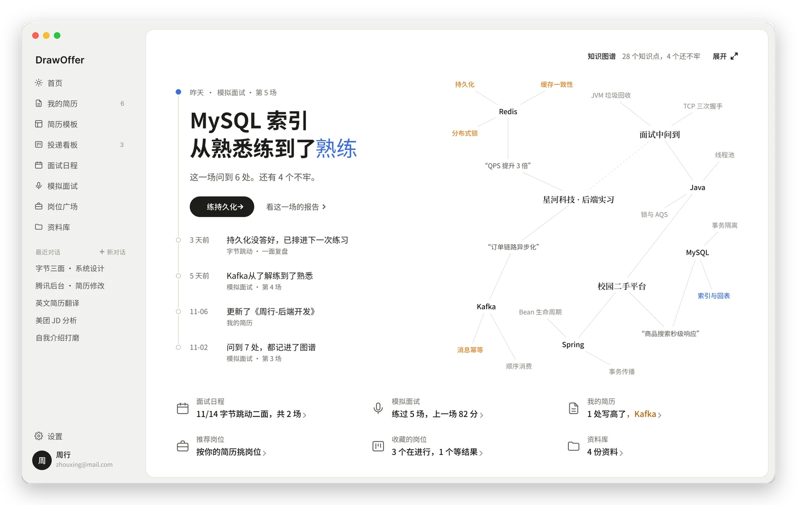

<h1>DrawOffer</h1>

<b>做懂你经历的 AI 求职搭档，也把我们在 RAG 和 AI 工程上的积累开源出来。</b> 
We build DrawOffer, an AI job-search partner with long-term memory, and open-source the RAG and AI tooling behind it.

<a href="https://www.drawoffer.com">官网</a> ·
<a href="https://www.drawoffer.com/assistant">在线使用</a> ·
<a href="https://github.com/DrawOffer/drawoffer">桌面客户端</a> ·
<a href="https://linkrag.cn">LinkRag</a>

## 🌟 产品

<table>
<tr>
<td width="58%"></td>
<td width="42%" valign="top">

### DrawOffer 职绘

把简历、投递、模拟面试和每一场真实面试存进**长期记忆**：改简历时知道你投的岗位，出题时知道你上次卡在哪。

- 📝 简历编辑与 AI 检查，60+ 套中文模板
- 📌 投递看板与面试日程
- 🎙 AI 模拟面试与复盘报告
- 🧠 知识图谱，标出还不牢的点

**[免费开始 →](https://www.drawoffer.com/assistant)** 
网页版 · 微信小程序 · [macOS / Windows](https://github.com/DrawOffer/drawoffer)

</td>
</tr>
</table>

**[LinkRag](https://linkrag.cn)** · 人人可用的企业级 RAG 系统：把复杂文档变成可以对话、可以溯源的知识。

## 📦 开源项目

**求职工具**

| 项目 | 说明 |
| --- | --- |
| [drawoffer](https://github.com/DrawOffer/drawoffer) | DrawOffer 的 macOS（SwiftUI）/ Windows（WinUI 3）原生桌面客户端 |
| [drawoffer-skills](https://github.com/DrawOffer/drawoffer-skills) | 简历与求职 Agent Skills，装进 Claude Code 即用：简历诊断、STAR 改写、简历翻译、面试准备 |
| [drawoffer-prompts](https://github.com/DrawOffer/drawoffer-prompts) | 求职提示词库，复制到任意 AI 助手：简历诊断、JD 匹配、面试准备与复盘 |
| [drawoffer-chinese-resume-templates](https://github.com/DrawOffer/drawoffer-chinese-resume-templates) | 57 套免费中文简历模板：校招、实习、社招，附预览图与示例数据 |
| [drawoffer-mcp](https://github.com/DrawOffer/drawoffer-mcp) | MCP Server：让 Claude、Cursor 读取你的简历、岗位和投递记录 |
| [DrawOffer-Eval](https://github.com/DrawOffer/DrawOffer-Eval) | DrawOffer 长期求职记忆引擎的独立测评 |

**RAG 与 AI 工程**

| 项目 | 说明 |
| --- | --- |
| [LinkRag](https://github.com/DrawOffer/LinkRag) | Python RAG 服务：文档解析、分片、向量化、索引与召回 |
| [LinkRag-Service](https://github.com/DrawOffer/LinkRag-Service) | LinkRag 的 Java 管理端：用户、配置、文件与任务编排 |
| [LinkRag-Web](https://github.com/DrawOffer/LinkRag-Web) | LinkRag 的 Web 前端：知识库可视化、对话与溯源 |
| [LinkRag-Eval](https://github.com/DrawOffer/LinkRag-Eval) | LinkRag 的独立检索评测 |
| [LinkParse](https://github.com/DrawOffer/LinkParse) | 纯 CPU 文档解析：PDF、DOC、DOCX 与图片转 Markdown |
| [LinkCli](https://github.com/DrawOffer/LinkCli) | 企业内部 MCP 聚合网关 |
| [LinkSpec](https://github.com/DrawOffer/LinkSpec) | Spec 驱动 + 文档治理的 AI 开发工具包 |

## 🤝 参与

- 用 DrawOffer 遇到问题或有想法：[提交 Issue](https://github.com/DrawOffer/drawoffer/issues)
- 觉得有用：给项目点个 ⭐，让更多同学看到

© DrawOffer

